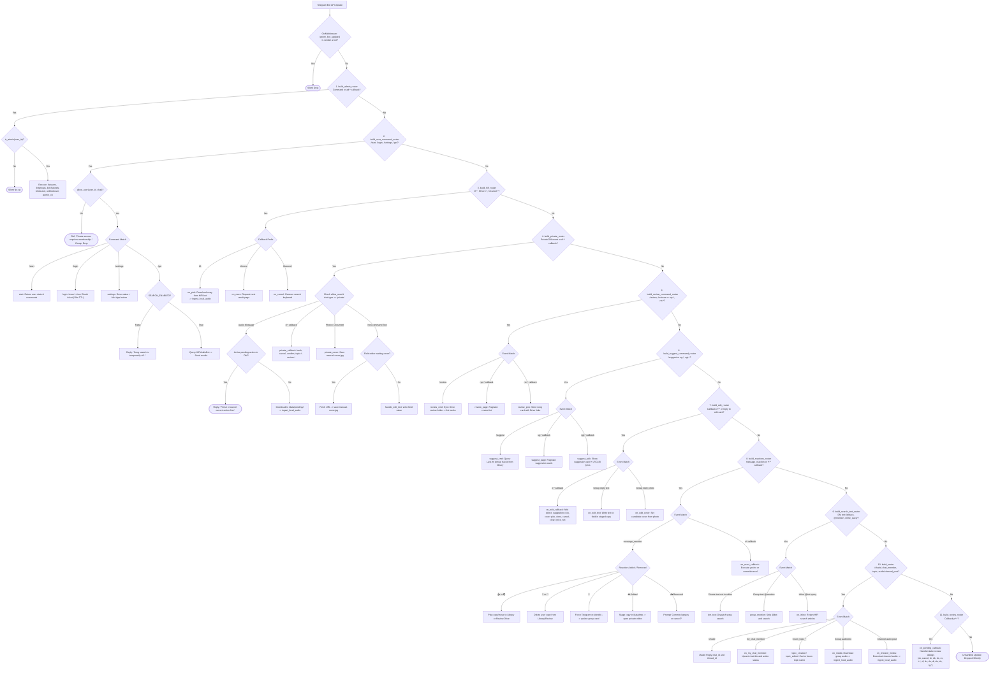
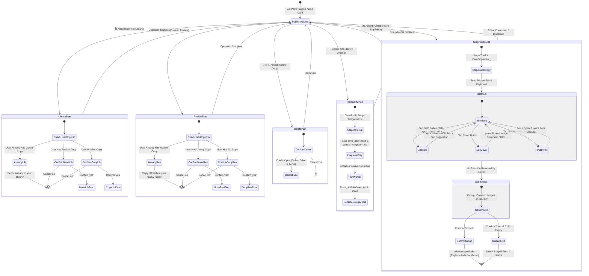
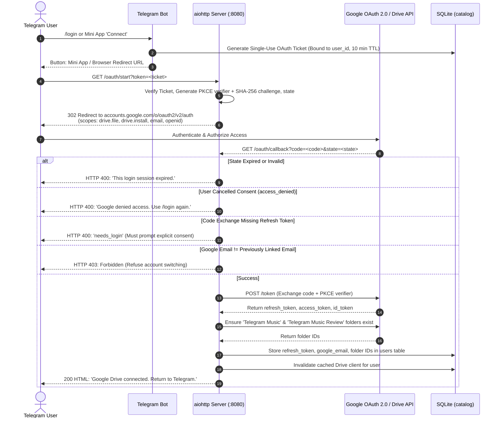

# MetaMusic Bot — System Process Specifications

Comprehensive operational and process flow specification for MetaMusic. This document defines the exact routing order, execution contracts, guard conditions, state machines, decision matrices, and edge-case caveats across all Telegram events, HTTP endpoints, background workers, and schedulers.

---

## 1. System Architecture & Dispatch Topology

```mermaid
flowchart TD
    subgraph Clients ["Clients & External Triggers"]
        TG_USER["Telegram User / Group / Channel"]
        TG_API["Telegram Bot API (Local / Cloud)"]
        WEB_USER["Telegram Mini App (Browser / WebView)"]
        TIMER["APScheduler (UTC Cron & Interval)"]
    end

    subgraph ServiceContainer ["bot Container (:8080)"]
        subgraph IngressLayer ["Ingress & Middleware"]
            MW["CtxMiddleware (Bot Filter & Ctx Inject)"]
            ERR["dp.errors (handle_update_error)"]
            ROUTERS["aiogram Dispatcher (11 Routers in Priority Order)"]
            HTTP_SRV["aiohttp Server (Mini App / API / OAuth)"]
        end

        subgraph CoreQueue ["Asynchronous Job Pipeline"]
            JOB_QUEUE[("asyncio.Queue[Job]")]
            WORKER_TASK[["Worker Task (worker / process_job)"]]
        end

        subgraph Persistence ["Persistence & Cache (/data)"]
            SQLITE[("SQLite (Catalog / state.db)")]
            PENDING_DIR["/data/pending (Staging & Working dirs)"]
            TMP_DIR["/data/tmp (Processing scratchpads)"]
            COVERS_DIR["/data/covers (Artwork cache)"]
            CACHE_DIR["/data/cache (Audio fingerprint cache)"]
        end

        subgraph Daemons ["Background Daemons"]
            BOOT_REC[["Boot Recovery (recover_interrupted)"]]
            INDEX_WARM[["Library Index Warmup (ensure_library_index)"]]
            CRON_EXPIRE[["Expire Pending (15-min Interval)"]]
            CRON_CLEANUP[["Daily Cleanup (03:00 UTC Cron)"]]
        end
    end

    subgraph ExternalServices ["External APIs & Integrations"]
        GOOGLE["Google Drive API (v3 OAuth / Files)"]
        MB["MusicBrainz API (Recordings / Releases / Artists)"]
        ACOUSTID["AcoustID API (fpcalc Audio Fingerprints)"]
        LASTFM["Last.fm API (Tags / Similar Songs)"]
        LRCLIB["LRCLIB API (Synced Lyrics .lrc)"]
        HIFI["HiFiAudioBot (Telethon User Session)"]
    end

    %% Client Ingress
    TG_USER -->|Updates| TG_API
    TG_API -->|Long Polling| MW
    MW --> ROUTERS
    MW -.->|Exceptions| ERR
    WEB_USER -->|HTTPS :8080| HTTP_SRV
    TIMER --> CRON_EXPIRE
    TIMER --> CRON_CLEANUP

    %% Internal Routing & Queues
    ROUTERS -->|Audio / HiFi Pick / Pray| JOB_QUEUE
    ROUTERS -->|Commands / Reactions| SQLITE
    JOB_QUEUE --> WORKER_TASK

    %% Worker Execution
    WORKER_TASK --> PENDING_DIR
    WORKER_TASK --> TMP_DIR
    WORKER_TASK --> SQLITE
    WORKER_TASK --> GOOGLE
    WORKER_TASK --> MB
    WORKER_TASK --> ACOUSTID
    WORKER_TASK --> LASTFM
    WORKER_TASK --> LRCLIB
    WORKER_TASK --> TG_API

    %% HTTP & OAuth
    HTTP_SRV --> SQLITE
    HTTP_SRV --> GOOGLE

    %% Maintenance & Background
    BOOT_REC --> SQLITE
    BOOT_REC --> JOB_QUEUE
    INDEX_WARM --> SQLITE
    INDEX_WARM --> GOOGLE
    CRON_EXPIRE --> SQLITE
    CRON_EXPIRE --> PENDING_DIR
    CRON_CLEANUP --> SQLITE
    CRON_CLEANUP --> PENDING_DIR
    CRON_CLEANUP --> TMP_DIR
    CRON_CLEANUP --> COVERS_DIR
    CRON_CLEANUP --> CACHE_DIR
    CRON_CLEANUP --> GOOGLE
```




### Ingress Middleware & Error Handling

1. `CtxMiddleware(ctx)` **(**`app/bot.py:81`**):**
  - Wraps all incoming updates before any router handler executes.
  - Injects `data["ctx"] = self.ctx` into workflow data.
  - Calls `ignore_bot_update(event, ctx.bot)`: Silently drops any update originated by this bot or another bot account (except `my_chat_member`).
2. `handle_update_error(event, ctx)` **(**`app/bot.py:93`**):**
  - Registered on `dp.errors`. Catches unhandled exceptions during handler execution.
  - Extracts `user_id` and `chat_id` from `update.message` or `update.callback_query`.
  - Dispatches sanitized error notification via `notify_error(ctx, user_id, exc, chat_id)`.

---


### Global Access Control (`allow_user`)

Evaluated at the start of individual handlers via `app/membership.py`:


| Caller Context                   | Evaluation Guard                                                                | Deny Action                                                                                   |
| -------------------------------- | ------------------------------------------------------------------------------- | --------------------------------------------------------------------------------------------- |
| **Env Admin**                    | `user_id == ADMIN_TELEGRAM_USER_ID`                                             | Always allowed (bypasses blacklists and DM membership checks).                                |
| **Bot Accounts**                 | `user.is_bot == True`                                                           | Dropped silently via `CtxMiddleware` or `user_is_bot()`.                                      |
| **Group / Supergroup / Channel** | `user_id NOT IN blacklist` **AND** `chat_id NOT IN blacklist`                   | Dropped silently. Unknown chats auto-registered into SQLite `chats`.                          |
| **Private DM**                   | User belongs to ≥1 known, non-blacklisted group (`DM_REQUIRES_KNOWN_CHAT=True`) | Deny text: `Private access requires membership in a known group.` (Cached 60s, 5m API grace). |
| **Mini App API** (`/api/`*)      | Valid Telegram `initData` HMAC **AND** `user_id NOT IN blacklist`               | HTTP 401 Unauthorized / HTTP 403 Forbidden.                                                   |


---


## 2. Telegram Update Ingress & Router Pipeline




---


### Slash Commands Registry


| Command               | Owning Router                  | Handler Function          | Guard / Scope | Arguments       | Operational Flow & Side Effects                                                                              |
| --------------------- | ------------------------------ | ------------------------- | ------------- | --------------- | ------------------------------------------------------------------------------------------------------------ |
| `/start`              | `build_user_command_router`    | `user_cmd.start`          | `allow_user`  | None            | Touches user; displays first seen date, songs edited, Drive status, commands list. Does **not** start OAuth. |
| `/login`              | `build_user_command_router`    | `user_cmd.login`          | `allow_user`  | None            | Generates single-use OAuth ticket URL (10 min TTL) with button to connect Drive.                             |
| `/settings`           | `build_user_command_router`    | `user_cmd.settings_cmd`   | `allow_user`  | None            | Displays current Drive connection & retention window; button to Mini App `/app/settings`.                    |
| `/get`                | `build_user_command_router`    | `user_cmd.get_cmd`        | `allow_user`  | `<query>`       | Song search. If `SEARCH_ENABLED=False`: replies with temporary off text. If `True`: queries HiFi bot.        |
| `/review`, `/reviews` | `build_review_command_router`  | `review_cmd.review_cmd`   | `allow_user`  | None            | Syncs remote Drive review folder; displays inline paginated song cards for user review tracks.               |
| `/suggest`            | `build_suggest_command_router` | `suggest_cmd.suggest_cmd` | `allow_user`  | `[query]`       | Seeds Last.fm query from user library index or query argument; returns interactive recommendation cards.     |
| `/chatid`             | `build_router`                 | `bot.chatid`              | Public        | None            | Diagnostic command. Returns HTML-formatted `chat_id` and `thread_id`.                                        |
| `/listusers`          | `build_admin_router`           | `admin_cmd.listusers`     | `is_admin`    | None            | Env admin only. Lists active users with first seen dates and inline block/unblock buttons.                   |
| `/listgroups`         | `build_admin_router`           | `admin_cmd.listgroups`    | `is_admin`    | None            | Env admin only. Lists all registered groups/supergroups with admin IDs and block toggles.                    |
| `/listchannels`       | `build_admin_router`           | `admin_cmd.listchannels`  | `is_admin`    | None            | Env admin only. Lists all registered broadcast channels with block toggles.                                  |
| `/blockuser`          | `build_admin_router`           | `admin_cmd.blockuser`     | `is_admin`    | `@user` or `ID` | Env admin only. Adds target user ID to SQLite `blacklist`. Cannot block self.                                |
| `/unblockuser`        | `build_admin_router`           | `admin_cmd.unblockuser`   | `is_admin`    | `@user` or `ID` | Env admin only. Removes target user ID from SQLite `blacklist`.                                              |


> [!NOTE]
> `/start` is registered in both `build_user_command_router` (`start`) and `build_private_router` (`private_start`). Because `build_user_command_router` is included at priority position 2 and `build_private_router` is at position 4, `user_cmd.start` **always intercepts** `/start` **first**.

---


### Callback Query Dispatch Registry


| Callback Prefix Pattern            | Target Router                  | Handler Function                | Purpose & Payload Schema                                                                                                                   |
| ---------------------------------- | ------------------------------ | ------------------------------- | ------------------------------------------------------------------------------------------------------------------------------------------ |
| `ad:(bu|uu|bg|bc|ug|uc|noop):<id>` | `build_admin_router`           | `admin_cmd.admin_cb`            | Admin block/unblock for users (`bu`/`uu`), groups (`bg`/`ug`), channels (`bc`/`uc`).                                                       |
| `hf:<pick_id>`                     | `build_hifi_router`            | `hifi.on_pick`                  | Selects search result song; triggers download and local ingest.                                                                            |
| `hfmore:<session_id>`              | `build_hifi_router`            | `hifi.on_more`                  | Requests next page of HiFi search results.                                                                                                 |
| `hfcancel:<session_id>`            | `build_hifi_router`            | `hifi.on_cancel`                | Cancels HiFi search session and clears keyboard.                                                                                           |
| `^d\d+:<action>`                   | `build_private_router`         | `private_ui.private_callback`   | Private DM dialog navigation (`cancel`, `back`, `confirm`, `topic:<id>`, `review:<idx>`).                                                  |
| `^rvp:\d+$`                        | `build_review_command_router`  | `review_cmd.review_page`        | Paginates through user review queue (`rvp:<page_number>`).                                                                                 |
| `^rvt:\d+$`                        | `build_review_command_router`  | `review_cmd.review_pick`        | Selects track card to inspect from review list (`rvt:<track_id>`).                                                                         |
| `^sg:\d+:\d+$`                     | `build_suggest_command_router` | `suggest_cmd.suggest_page`      | Paginates Last.fm suggestions (`sg:<session_id>:<page>`).                                                                                  |
| `^sgt:\d+:\d+$`                    | `build_suggest_command_router` | `suggest_cmd.suggest_pick`      | Selects suggested song card and pulls synced lyrics (`sgt:<session_id>:<idx>`).                                                            |
| `^e\d+:<action>`                   | `build_edit_router`            | `edit_ui.on_edit_callback`      | Interactive tag/cover editor actions (`f:<field>`, `s:<field>:<idx>`, `cv:<idx>`, `done`, `cancel`, `clear`, `lyrics_net`).                |
| `^r\d+:(yes|no|cancel|commit)`     | `build_reactions_router`       | `reactions.on_react_callback`   | Reaction confirm/cancel (`yes`/`no`) or `✍️` tag editor exit (`commit`/`cancel`).                                                          |
| `^p\d+:<action>`                   | `build_review_router`          | `review_ui.on_pending_callback` | Intake review callbacks (`ok`, `cancel`, `dr`, `dk`, `ds`, `cv<N>`, `c<N>`, `t:<field>`, `dl`, `dv`, `dn`, `dt`, `da`, `do`, `lg:<lang>`). |


---


### Non-Command Message & Event Handlers


| Event Type / Filter                                           | Owning Router              | Handler Function           | Scope & Conditions                            | Execution Behavior                                                                                                        |
| ------------------------------------------------------------- | -------------------------- | -------------------------- | --------------------------------------------- | ------------------------------------------------------------------------------------------------------------------------- |
| `F.chat.type == "private" & AudioMessageFilter()`             | `build_private_router`     | `private_ui.private_media` | Private DM only                               | Rejects if user has active pending action. Downloads audio to `/data/pending/` and calls `ingest_local_audio`.            |
| `(F.document | F.audio)`                                      | `build_router`             | `bot.on_media`             | Group / Supergroup (`chat.type != "private"`) | Filters known audio and `listen_for` formats. Downloads file and calls `ingest_local_audio`.                              |
| `channel_post(F.document | F.audio)`                          | `build_router`             | `bot.on_channel_media`     | Broadcast Channel Posts                       | Ingests channel audio post via `ingest_local_audio`. Original post is preserved.                                          |
| `F.chat.type == "private" & (F.photo | F.document)`           | `build_private_router`     | `private_ui.private_cover` | Private DM                                    | Active cover editor input. Ingests photo or image document (max 15MB) as `manual-cover.jpg`.                              |
| `F.photo | F.document`                                        | `build_edit_router`        | `edit_ui.on_edit_cover`    | Group / Channel (Reply to Card)               | Reply with an image to an active edit card in a group sets candidate cover art.                                           |
| `F.chat.type == "private" & F.text & ~F.text.startswith("/")` | `build_private_router`     | `private_ui.private_text`  | Private DM Non-Command                        | If editing cover: parses image URL. Else: passes text to `handle_edit_text`. Always consumes update (prevents DM search). |
| `F.text & ~F.text.startswith("/")`                            | `build_edit_router`        | `edit_ui.on_edit_text`     | Group Reply to Card                           | Writes reply text directly into active tag field (`handle_edit_text`). Skips if unhandled.                                |
| `F.chat.type == "private" & F.text`                           | `build_search_text_router` | `user_cmd.dm_text`         | Private DM (Fallback)                         | Reached only if no pending edit session exists. Dispatches song search via `_start_search`.                               |
| `F.text` (mentions bot username)                              | `build_search_text_router` | `user_cmd.group_mention`   | Group / Supergroup                            | Extracts query by stripping `@botname` mention and calls `_start_search`.                                                 |
| `router.inline_query()`                                       | `build_search_text_router` | `user_cmd.on_inline`       | Global Inline Queries                         | If `SEARCH_ENABLED=False`: returns empty cache. If `True`: provides search article preview.                               |
| `router.my_chat_member()`                                     | `build_router`             | `bot.on_my_chat_member`    | Group / Channel membership updates            | Records chat ID, type, title, and active membership status in SQLite `chats`.                                             |
| `F.forum_topic_created`                                       | `build_router`             | `bot.topic_created`        | Forum Supergroups                             | Caches `message_thread_id` and topic name in SQLite `topics`.                                                             |
| `F.forum_topic_edited`                                        | `build_router`             | `bot.topic_edited`         | Forum Supergroups                             | Updates cached topic title in SQLite `topics`.                                                                            |


---


## 3. Audio Ingestion & Worker Pipeline

All audio sources (Telegram group audio, channel posts, private DM audio, and HiFi search picks) funnel into `ingest_local_audio`.

```mermaid
flowchart TD
    %% Ingress to Intake
    SRC["Audio Ingest Source<br/>(Group / Channel / DM / HiFi Pick / Pray)"] --> G_MIME{"Valid Audio MIME / Extension?"}
    G_MIME -->|No| DROP1(["Silent Drop"])
    G_MIME -->|Yes| G_USER{"Valid Sender & Not Bot?"}
    G_USER -->|No| DROP2(["Silent Drop"])
    G_USER -->|Yes| G_AUTH{"allow_user Passed?"}
    G_AUTH -->|No| DROP3(["DM Membership Error / Silent Drop"])
    G_AUTH -->|Yes| G_FMT{"Format in user.listen_for?<br/>(Default: flac, mp3)"}
    G_FMT -->|No| DROP4(["Silent Drop (Format Ignored)"])
    G_FMT -->|Yes| G_RATE{"Upload Rate Limit Passed?"}
    G_RATE -->|No| E_RATE(["Reply: Upload Rate Exceeded"])
    G_RATE -->|Yes| G_SHA{"SHA-256 in user library/review?"}
    G_SHA -->|Yes| DUP_SHA["Send Audio Card: 'already in library/review'<br/>Halt Ingestion"]
    G_SHA -->|No| INTAKE["ingest_local_audio():<br/>1. Post public playable card 'identifying...'<br/>2. Insert pending_reviews (phase=intake, status=queued)<br/>3. Enqueue Job to asyncio.Queue"]

    %% Worker Execution
    subgraph WorkerExecution ["Tagger Worker: process_job() (app/queue.py)"]
        INTAKE --> W_COPY["Download / Copy audio to /data/tmp/<uuid>/<br/>(Strictly NO transcoding or re-encoding)"]
        W_COPY --> W_HINTS["Read embedded Mutagen tags & filename hints"]
        W_HINTS --> W_FP["AcoustID Fingerprinting (fpcalc) -> MusicBrainz Query"]
        W_FP --> W_ENRICH["Metadata Enrichment:<br/>1. Last.fm Genre / Mood tags<br/>2. LRCLIB Synced Lyrics (.lrc)<br/>3. iTunes / Cover Art Archive candidates"]
        W_ENRICH --> W_AUTH{"authenticity_check Enabled?"}
        W_AUTH -->|Yes| W_SPEC["analyze_flac(): Spectrum & Bit Depth Check"]
        W_AUTH -->|No| W_CONF
        W_SPEC --> W_CONF{"Identity Confidence >= Threshold?"}

        %% Low Confidence Branch
        W_CONF -->|Low Confidence| W_LOW["Human Tag Review Required:<br/>Group: Tag-diff keyboard (file vs rec)<br/>DM: Field-by-field interactive editor"]
        W_LOW --> W_WAIT_TAGS[("status = 'waiting', phase = 'tags'<br/>(Expires after 24h)")]

        %% High Confidence Branch
        W_CONF -->|High Confidence| W_MBID_CHECK{"Same MBID in User Library?"}
        W_MBID_CHECK -->|Yes & Incoming Quality <= Old| W_SKIP_MBID["Skip Drive Upload<br/>Caption: 'Duplicate — already in library'"]
        W_MBID_CHECK -->|Yes & Incoming Quality > Old| W_UPGRADE["Quality Upgrade: Replace older copy in Drive"]
        W_MBID_CHECK -->|No Duplicate| W_COMMIT["Standard Commit Pipeline"]

        %% Commit Pipeline
        W_UPGRADE --> W_LANG
        W_COMMIT --> W_LANG{"Genre has >= 2 Languages?"}
        W_LANG -->|Yes| W_LANG_PROMPT["Prompt Primary Language Selection<br/>(Folder name only; tags retain all)"]
        W_LANG -->|No| W_COVER
        W_LANG_PROMPT -->|User Selects Language| W_COVER{"Album Shareable & > 1 Cover Options?"}

        W_COVER -->|Follower Track| W_COV_FOLLOWER["Wait for Album Leader Track Pick"]
        W_COVER -->|Leader Track| W_COV_PICKER["Send Cover Gallery Picker Keyboard"]
        W_COVER -->|1 Option / None| W_DEST
        W_COV_PICKER -->|User Selects Cover| W_DEST{"Prompt Destination?<br/>(Drive Connected & Not Skipped)"}
        W_COV_FOLLOWER -->|Leader Chosen| W_DEST

        W_DEST -->|Prompt Needed| W_DEST_PROMPT["Send Destination Keyboard:<br/>Library / Review / No Drive Upload"]
        W_DEST -->|Skipped / Logged Out| W_DEST_AUTO["Use Default User Destination"]
        W_DEST_PROMPT -->|User Selects Dest| W_CONFLICT
        W_DEST_AUTO --> W_CONFLICT{"Drive Name Conflict in Target Folder?"}

        W_CONFLICT -->|Conflict Detected| W_CONF_PROMPT["Prompt Conflict Action:<br/>Replace / Keep both / Skip"]
        W_CONFLICT -->|No Conflict| W_FINALIZE
        W_CONF_PROMPT -->|User Commits| W_FINALIZE["1. Write Normalized Mutagen Tags to Disk<br/>2. Upload Audio (+ Cover & Sidecar) to Drive<br/>3. Update Public Card Caption & Media<br/>4. Optionally Delete User Original Upload"]
        W_FINALIZE --> W_DONE[("status = 'done', mark completed")]
    end
```




---


### Pre-Ingest Gates (`ingest_local_audio`)

Evaluated sequentially. Stop on first match:

1. **Type Check:** Must be recognized audio MIME or extension. Non-audio is silently dropped.
2. **Sender Origin:** Drop if anonymous, channel forward without user, or sent by bot.
3. **Access Control:** User and chat must pass `allow_user`.
4. **Format Filter:** File format must be in `user.settings.listen_for` (default: `['flac', 'mp3']`). Allowed-but-disabled formats (e.g. `m4a`, `ogg`, `opus`, `wav` when unselected) are ignored with **no error**.
5. **DM Concurrency Gate:** If private DM, reject if user already has an active pending review (`status IN ('waiting', 'processing')`). Reply: `Finish or cancel current action first.`
6. **Rate Limit:** Per-user sliding window. Exceeded → brief user warning.
7. **SHA Deduplication:** Compute SHA-256. If matching hash exists in user's library/review:
  - Re-send existing public card with caption: `Already in library/review`.
  - Halt processing.
8. **Enqueuing:**
  - Post placeholder card: `identifying...`.
  - Insert `pending_reviews(status='queued', phase='intake', expires_at=NOW() + 24h)`.
  - Put `Job(chat_id, message_id, file_id)` on `asyncio.Queue`.

---


### Decision Matrix: Duplicate Identification vs Quality


| Existing MBID in User Library | Incoming vs Existing Quality           | Ingestion Action                                | User / Public Notification                  |
| ----------------------------- | -------------------------------------- | ----------------------------------------------- | ------------------------------------------- |
| **No**                        | *N/A*                                  | Continue standard commit pipeline.              | Normal card updates.                        |
| **Yes**                       | `incoming.bitrate <= existing.bitrate` | Abort ingestion; skip Drive upload.             | Caption: `Duplicate — already in library`.  |
| **Yes**                       | `incoming.bitrate > existing.bitrate`  | Replace existing file in Drive & library index. | Caption: `Upgraded to higher quality file`. |


---


### Decision Matrix: Setting × Login Execution


| Operation                 | Logged Out                                  | Logged In (`dest = 'none'`)                                        | Logged In (`dest = 'library'` / `'review'`)                        |
| ------------------------- | ------------------------------------------- | ------------------------------------------------------------------ | ------------------------------------------------------------------ |
| **Dest Prompt**           | **Skipped** (dest locked to `none`).        | Shown unless `skip_save_prompt = True`.                            | Shown unless `skip_save_prompt = True`.                            |
| **Drive Upload**          | Never executed.                             | Skipped.                                                           | Uploaded to `Telegram Music` or `Telegram Music Review`.           |
| **Language Tree**         | Folder name used for caption/indexing only. | Drive path `/{language}/...`                                       | Drive path `/{language}/...`                                       |
| **Correct Telegram File** | Caption-only (unless `🙏` or `✍️`).         | Replaces media if toggle is `True`.                                | Replaces media if toggle is `True`.                                |
| **Delete Original**       | Deletes upload if toggle is `True`.         | Deletes upload if toggle is `True`.                                | Deletes upload if toggle is `True`.                                |
| **👍 / 👎 Reaction**      | Local SQLite user copy only.                | Copies/moves file in user's Drive.                                 | Copies/moves file in user's Drive.                                 |
| **Daily Cleanup Cron**    | Drop local file after **7 days**.           | Retain local file 7 days post-upload, then drop if Drive verified. | Retain local file 7 days post-upload, then drop if Drive verified. |


---


## 4. Interactive Reactions & Tag Editor State Machine

Users interact with published audio cards using Telegram emoji reactions.




---


### Decision Matrix: Reaction × Existing User Copy


| Existing User Copy        | 👍 (Move / Save Library)                           | 👎 (Move / Save Review)                           | 💩 or 🙉 (Delete Copy)                           |
| ------------------------- | -------------------------------------------------- | ------------------------------------------------- | ------------------------------------------------ |
| **None**                  | Confirm: Copy Telegram file → User's Library Drive | Confirm: Copy Telegram file → User's Review Drive | No-op: `Track not in your library.`              |
| **In Library (Uploaded)** | No-op: `Already in your library.`                  | Confirm: **Move** Drive file Library → Review     | Confirm: **Delete** user's Drive & local copies. |
| **In Review (Uploaded)**  | Confirm: **Move** Drive file Review → Library      | No-op: `Already in your review folder.`           | Confirm: **Delete** user's Drive & local copies. |


---


## 5. Google OAuth 2.0 (PKCE) & Drive Synchronization




---


### OAuth Failure Modes & Error Codes


| Failure Code     | Underlying Cause                                                       | Recovery Instruction to User                                                       |
| ---------------- | ---------------------------------------------------------------------- | ---------------------------------------------------------------------------------- |
| `ticket_expired` | Reused or TTL passed (>600s).                                          | Run `/login` again to issue a fresh ticket.                                        |
| `access_denied`  | User clicked Cancel on Google consent screen.                          | Run `/login` again when ready.                                                     |
| `invalid_grant`  | Refresh token expired (~7 days in Testing mode) or revoked.            | Prompt: `Google login expired. Use /login again.`                                  |
| `email_mismatch` | User attempted to link a different Google email than previously bound. | HTTP 403. User must disconnect old account or re-authenticate with original email. |
| `needs_login`    | Token exchange returned no refresh token (missing `prompt=consent`).   | Re-run `/login` to trigger explicit consent prompt.                                |


---


## 6. Scheduled Daemons & Background Maintenance

All scheduled processes run inside the primary `bot` container. APScheduler coordinates interval and cron schedules; asynchronous background tasks handle job queues and indexing.

```mermaid
flowchart TD
    %% Boot Sequence
    subgraph BootSequence ["Container Boot Sequence (app/bot.py:main)"]
        BOOT["python -m app"] --> B_SCHED["Initialize APScheduler (UTC)"]
        BOOT --> B_WORKER["Spawn Tagger Worker (asyncio task)"]
        BOOT --> B_WAIT["Wait for Local Bot API Health (:8081)"]
        B_WAIT --> B_HTTP["Bind aiohttp Server (:8080)"]
        B_HTTP --> B_REC["Run Boot Recovery: recover_interrupted()"]
        B_REC --> B_WARM["Spawn Library Index Warmup (background task)"]
        B_WARM --> B_POLL["Start aiogram Long Polling"]
    end

    %% Periodic Schedules
    subgraph PeriodicSchedules ["Scheduled Cron Daemons (APScheduler)"]
        SCHED_15["Interval: Every 15 Minutes"] --> CRON_P15["run_expire_pending()"]
        SCHED_DAILY["Cron: Daily at 03:00 UTC (CLEANUP_CRON)"] --> CRON_DAILY["run_cleanup()"]
    end

    %% 15-Minute Expiration Flow
    subgraph ExpirePendingFlow ["15-Minute Expiration: run_expire_pending()"]
        CRON_P15 --> P_QUERY["Query: status = 'waiting' AND expires_at <= NOW()<br/>(Excludes react_edit, react_confirm with ~10-yr expiry)"]
        P_QUERY --> P_PHASE{"Evaluate Phase"}
        P_PHASE -->|phase = 'tags'| P_TAGS["Auto-commit current tags -> route to Review Drive folder"]
        P_PHASE -->|phase = 'cover'| P_COVER["Select candidate cover #1 -> promote followers -> proceed to Drive"]
        P_PHASE -->|phase = 'drive'| P_DRIVE["Abort Drive upload -> retain file in local cache"]
        P_PHASE -->|phase = 'react_exit'| P_EXIT["Discard staged /data/tmp copy -> unlock track ('Edit timed out')"]
        P_PHASE -->|phase IN (intake, lang, dest)| P_PURGE["Delete files in /data/pending -> set status = 'expired'"]
    end

    %% Daily Cleanup 13-Step Flow
    subgraph DailyCleanupFlow ["Daily Maintenance: run_cleanup() (13 Sequential Stages)"]
        CRON_DAILY --> S1["1. run_expire_pending()"]
        S1 --> S2["2. Drive Retry (status='failed')"]
        S2 --> S3["3. Sweep Drive-Confirmed Local Files (>7 days)"]
        S3 --> S4["4. Prune Logged-Out Local Files (>7 days)"]
        S4 --> S5["5. Clean /data/cache Unused Entries (>7 days)"]
        S5 --> S6["6. Forget Idle Users (>3 months inactive)"]
        S6 --> S7["7. Recursively rmdir Empty Local Directories"]
        S7 --> S8["8. Sweep /data/tmp Files (>7 days)"]
        S8 --> S9["9. Sweep /data/covers Files (>7 days)"]
        S9 --> S10["10. Sweep Leftover Bot API Downloads (>24h)"]
        S10 --> S11["11. Hard-Delete Finished pending_reviews (>30 days)"]
        S11 --> S12["12. Purge Expired /suggest Sessions & Last.fm Cache"]
        S12 --> S13["13. Sweep Empty Remote Drive Review Folders"]
    end
```


---


### Boot Recovery Matrix (`recover_interrupted`)

Executed once at boot before polling starts:


| Interrupted State & Phase                      | Recovery Action                                              | Restored Status & Phase                    |
| ---------------------------------------------- | ------------------------------------------------------------ | ------------------------------------------ |
| `cleanup_pending` (any status)                 | Delete leftover review folder source file in Drive.          | `status = 'done'`                          |
| `phase = 'intake'` (`queued` / `processing`)   | Re-enqueue `Job` into `asyncio.Queue`.                       | `status = 'queued'`, `phase = 'intake'`    |
| `phase = 'dm_topic'` (`queued` / `processing`) | Re-enqueue `Job` into `asyncio.Queue`.                       | `status = 'queued'`, `phase = 'dm_topic'`  |
| `status = 'uploading'`                         | Set destination to Drive; auto-apply `Replace` on collision. | `status = 'processing'`, `phase = 'drive'` |
| `phase = 'dest'`                               | Restore destination selection keyboard in Telegram.          | `status = 'waiting'`, `phase = 'dest'`     |
| `phase = 'lang'` or `'cover'`                  | Restore active gallery pickers and language selectors.       | `status = 'waiting'`                       |
| Any other interrupted state                    | Fallback to waiting state.                                   | `status = 'waiting'`                       |


---


### Passive TTL & Cache Invalidation Registry


| Entity                          | Time-To-Live (TTL)           | Expiration Trigger                                | Fallback Action on Expiry                        |
| ------------------------------- | ---------------------------- | ------------------------------------------------- | ------------------------------------------------ |
| **OAuth Ticket / State**        | 600 seconds (10 min)         | Evaluated on `/oauth/start` or `/oauth/callback`. | Rejection: `This login session expired.`         |
| **Mini App** `initData`         | 300 seconds (5 min)          | Evaluated on every `/api/`* request.              | HTTP 401: `Unauthorized / Session expired.`      |
| **HiFi Result Buttons**         | 1 hour                       | Evaluated on inline button click.                 | Telegram notification: `Search session expired.` |
| **Suggest Interactive Session** | 24 hours                     | Evaluated on page / pick callback.                | Session reset: `Suggestion session expired.`     |
| **Membership Check Cache**      | 60 seconds (5 min API grace) | Evaluated on private DM access gate.              | Re-queries Telegram `getChatMember`.             |
| **Google Refresh Token**        | ~7 days (Testing mode)       | Evaluated on any Google Drive API request.        | Marks user `needs_login`; halts remote sync.     |


---


## 7. System States & Key References


### `pending_reviews` Lifecycle State Machine


| Phase             | Valid Statuses          | Description                                                                          |
| ----------------- | ----------------------- | ------------------------------------------------------------------------------------ |
| `intake`          | `queued`, `processing`  | Audio file downloaded, waiting for worker AcoustID identification.                   |
| `tags`            | `waiting`, `processing` | Low-confidence metadata match awaiting user approval of tag-diff keyboard.           |
| `cover`           | `waiting`, `processing` | Multiple artwork candidates detected; awaiting user pick on leader track.            |
| `lang`            | `waiting`, `processing` | Multiple languages detected on genre; awaiting folder language selection.            |
| `dest`            | `waiting`, `processing` | Identification complete; awaiting user destination choice (Library / Review / None). |
| `drive`           | `waiting`, `processing` | Name conflict in Google Drive target folder; awaiting Replace / Keep both / Skip.    |
| `react_edit`      | `waiting`, `processing` | Active collaborative tag editor session (`✍️` added).                                |
| `react_exit`      | `waiting`               | Editor session closing (`✍️` removed); awaiting Commit or Cancel.                    |
| `react_confirm`   | `waiting`, `processing` | Awaiting confirmation for 👍 (Library), 👎 (Review), 💩 (Delete), or 🙏 (Restart).   |
| `cleanup_pending` | `processing`, `done`    | Promoted review track awaiting deletion of old remote source file in Drive.          |


---


### Audio Handling & Tagging Invariants

1. **Zero Transcoding Invariant:** Audio is **never** re-encoded, downsampled, or transcoded. Bit depth, sample rate, and codec remain 100% identical to the source file.
2. **Tags Written:** `TITLE`, `ALBUM`, `ARTIST`, `ALBUMARTIST`, `COMPOSER`, `GENRE`, `DATE`, `TRACKNUMBER`, `DISCNUMBER`, `LYRICS` (synced LRCLIB only), front cover art.
3. **Tags Stripped:** All unlisted tags, comments, vendor strings, encoder notes, and private metadata blocks.
4. **Data Isolation:** User operations via reactions or Mini App APIs are cryptographically scoped via `initData` HMAC and verified Telegram user IDs. Users cannot inspect, overwrite, or delete audio or Google Drive files belonging to other users.
5. **Stack Trace Sanitization:** Telegram chat replies and HTTP HTML responses **never** contain raw stack traces, file system paths, database credentials, or OAuth tokens. Errors map to human-friendly codes (`needs_login`, `busy`, `expired`).

